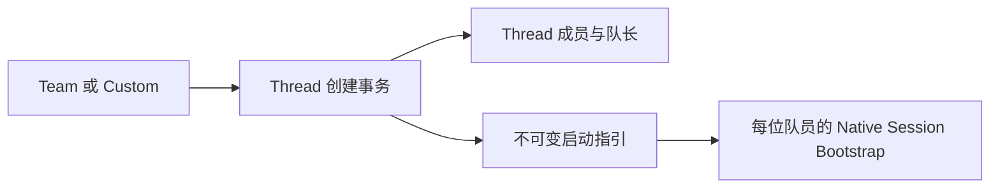

# Team 管理

Team 提供可复用的 Thread/Mission 创建输入。持久化与准入由 Core `teams` 模块拥有；Renderer 只保留编辑草稿、
选择与命令回执恢复。协议见 [Team Templates v2](../contracts/team-templates-v2.md)，界面见
[Team 工作区](../ui/components/team-workspace.md)。

`creation_preferences` 只拥有共享创建来源、一键开启和独立 Custom 名册，Main 保留语言、启动位置等
本机展示偏好。旧文件导入与 Team 删除后的默认回退在 SQLite 事务中完成，避免跨文件部分提交。
Team 保存、删除和 Thread 创建复用 Domain Command Gateway；CAS 版本拒绝跨端覆盖，运输未知结果
保留同一命令 ID 核对回执。

创建后 Thread 的动态成员、Default Lead、消息与 Runtime 生命周期沿用各自领域；不订阅 Team 内容。
`thread_team_bootstrap` 只存非空原文，更新触发器拒绝改写，Thread 清理时级联删除；不作为 Renderer
可编辑配置、动态上下文或 Agent 的 Team 管理接口。Bootstrap 版本和证据边界见
[Bootstrap v6](../contracts/native-session-bootstrap-v6.md)。

Migration 213 从主线 schema 162 升至 163，沿用 v1.72 Data Contract；新表与 Bootstrap 准入扩展整体提交，
不清理绑定、不重写历史输入、不自动把旧默认队伍升级成 Team。真实模型回归和 UI 夹具验收的能力边界
分别记录在[实施记录](../versions/v1.72/team-management-implementation.md)。

Migration 214 从 schema 163 升至 164，仅扩宽两张指引表的长度约束至 10000 个 Unicode scalar；
复用原事务迁移及表重建机制，保留正文、回执、默认配置和 Thread 启动材料的不可变性。

Mission 的创建入口复用同一 `create_camp_in_tx`，先解析 Team 权威 roster/Lead，再并入描述提及的
额外成员，Mission 与冻结指引原子提交。不从 Renderer 名册重建 Team；没有 Mission 专用启动材料。
User 创建 Mission 不更新全局默认偏好，生命周期与上下文仍归既有 Thread owner。
